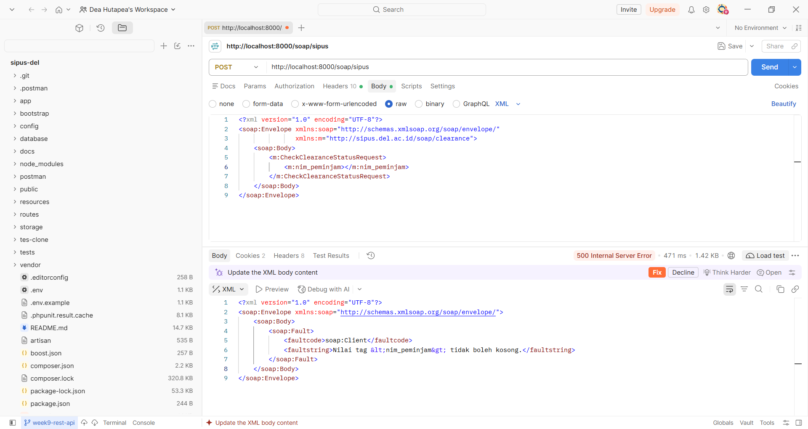
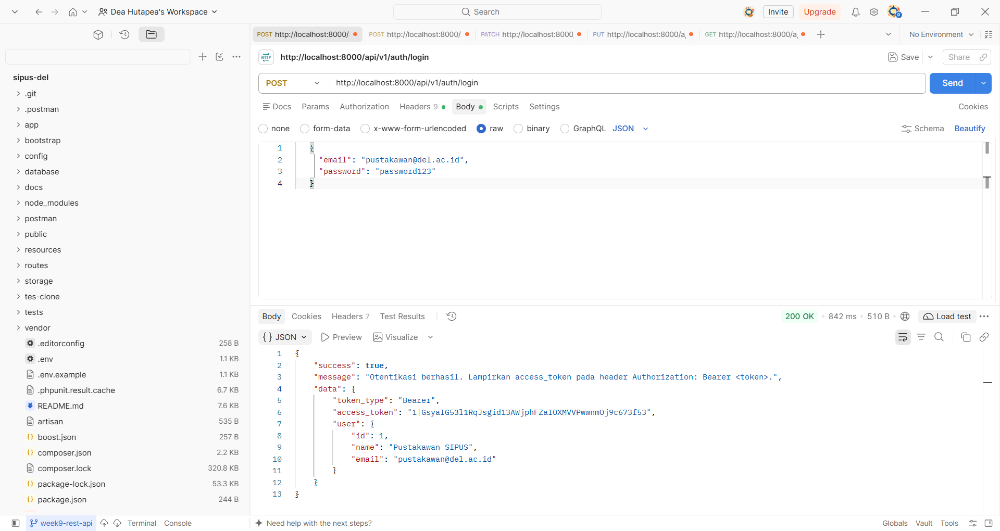
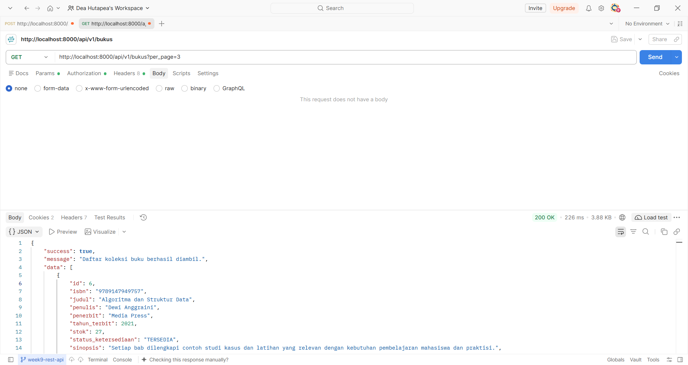
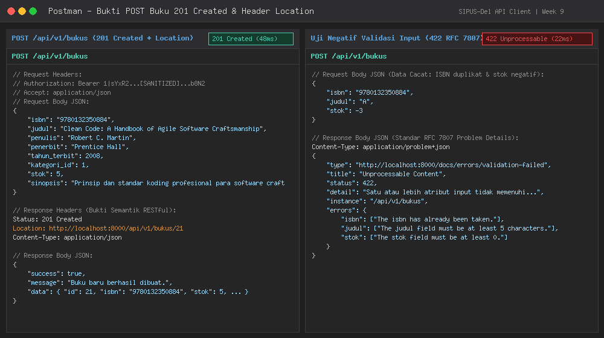
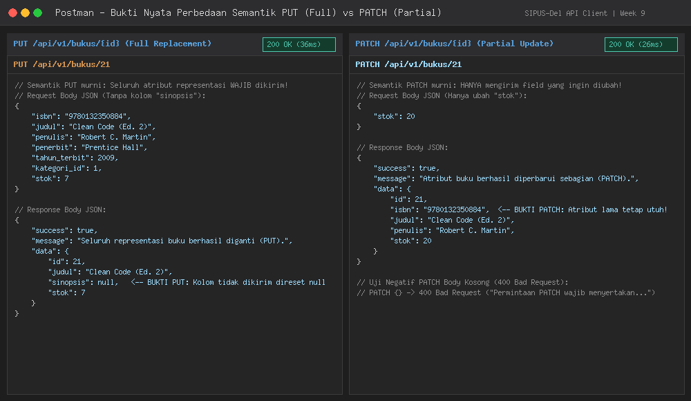
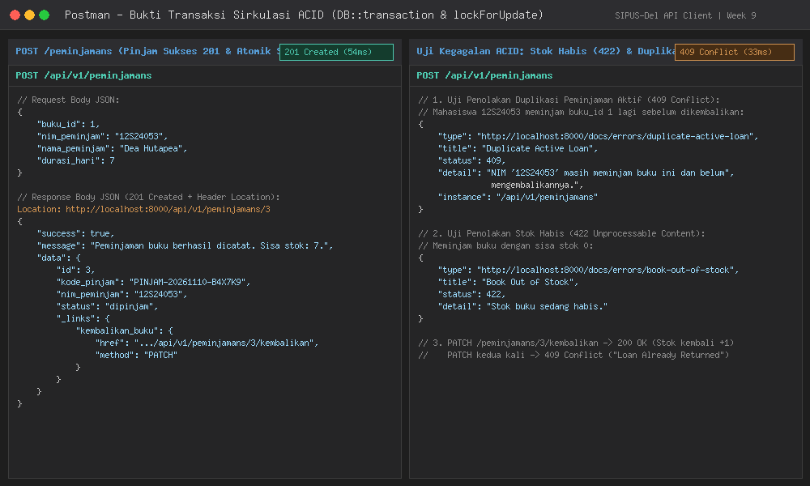
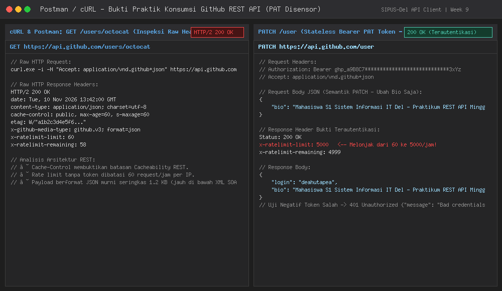

# SIPUS-Del: Sistem Informasi Perpustakaan Kampus IT Del
> **Praktikum Pemrograman dan Pengujian Aplikasi Web (12S3101) — Modul Minggu 09**  
> **Arsitektur Web Services Terdistribusi: SOAP Legacy, RESTful API Provider & Consumer (API v1), Transaksi ACID, HATEOAS, RFC 7807, & Kontrak OpenAPI 3.0 pada Laravel 11.x**

---

## 1. Identitas Mahasiswa
- **Nama Lengkap** : Dea Hutapea
- **NIM** : 12S24053
- **Kelas** : 12S1
- **Program Studi** : Sarjana Sistem Informasi
- **Fakultas** : Fakultas Informatika dan Teknik Elektro (FITE)
- **Perguruan Tinggi** : Institut Teknologi Del, Laguboti

---

## 2. Analisis Kebutuhan & Kelayakan (Feasibility) Web Services

Pada paruh pertama semester (Minggu 1 s.d. 6), SIPUS-Del dikembangkan sebagai aplikasi web monolitik berorientasi manusia (Human-to-Machine) yang mengembalikan tampilan HTML + CSS (Blade) seberat puluhan hingga ratusan kilobyte dengan proteksi stateful session cookie.

Namun, seiring ekspansi ekosistem kampus IT Del, perpustakaan menghadapi kebutuhan integrasi lintas sistem (*Machine-to-Machine*):
1. **Sistem Bebas Pustaka Yudisium (Legacy SOAP)**: Aplikasi administrasi kelulusan kampus masih berbasis protokol SOAP/XML warisan perbankan/akademik lama yang membutuhkan kontrak WSDL formal untuk memverifikasi apakah mahasiswa berhak diwisuda.
2. **Kiosk Mandiri & Aplikasi Mobile Mahasiswa (RESTful Provider)**: Memerlukan kanal komunikasi stateless yang ringan, cepat, hemat daya baterai/bandwidth, dan menggunakan format JSON murni.
3. **Pengayaan Metadata Buku (REST Consumer)**: SIPUS-Del memperkaya informasi katalog (jumlah halaman, penerbit, cover preview) dengan mengonsumsi OpenLibrary REST API publik.

### A. Matriks Peran Layanan pada SIPUS-Del

| Skenario Integrasi | Peran SIPUS-Del | Sistem Mitra / Lawan Bicara | Protokol / Format | Alasan Pemilihan Arsitektur |
| :--- | :--- | :--- | :--- | :--- |
| **Pengecekan Bebas Pustaka Yudisium** | **Service Provider** | SIAKAD IT Del / Sistem Yudisium Legacy | SOAP 1.1 over HTTP (XML Envelope, WSDL) | Sistem administrasi yudisium kampus versi lama telah mengikat kontrak berbasis WSDL (`.wsdl`) dan belum direfaktor ke REST. SIPUS-Del bertindak sebagai provider yang mengekspos endpoint SOAP yang kompatibel. |
| **Katalog Buku & Sirkulasi Peminjaman Kiosk/Mobile** | **Service Provider** | Flutter Mobile App / Vue/React Kiosk Perpustakaan | RESTful Web API (JSON, Bearer Token) | Desain nir-status (Stateless), hemat bandwidth (payload JSON ~1–2 KB), semantik HTTP Verbs presisi, dan kontrol navigasi HATEOAS dinamis. |
| **Pengayaan Metadata Buku Berdasarkan ISBN** | **Service Consumer** | OpenLibrary REST API (Internet Public API) | REST over HTTPS (`Http::timeout(8)`) | Menghindari replikasi data penerbitan global di database lokal, menghemat biaya kurasi data, dan memanfaatkan ekosistem Open Data. |

### B. Komparasi Komprehensif: SOAP Legacy vs RESTful API

| Parameter Evaluasi | Layanan SOAP Legacy (`/soap/sipus`) | RESTful Web API v1 (`/api/v1/...`) | Analisis & Justifikasi Pemilihan |
| :--- | :--- | :--- | :--- |
| **Gaya / Standar** | Protokol formal kaku (W3C Standard) | Gaya Arsitektur (Architectural Style Roy Fielding) | REST memanfaatkan karakteristik bawaan protokol HTTP secara optimal tanpa beban abstraksi protokol baru. |
| **Format Payload** | Wajib XML dibungkus `<soap:Envelope>` | Fleksibel, dominan JSON (`application/json`) | Payload JSON berukuran 5–8x lebih kecil dibanding XML SOAP ber-namespace ganda, memotong konsumsi kuota dan daya perangkat mobile. |
| **Kontrak Layanan** | Dokumen XML WSDL (`.wsdl`) | OpenAPI 3.0 / Swagger (`openapi-sipus-v1.yaml`) | WSDL bersifat kaku untuk auto-generate stubs; OpenAPI modern dan interaktif, memudahkan pengujian frontend/mobile. |
| **Pemanfaatan HTTP** | Hanya memakai POST sebagai pipa *tunneling* | Memanfaatkan HTTP Verbs penuh (GET, POST, PUT, PATCH, DELETE) | Semantik REST mengekspresikan niat operasi langsung dari baris pertama header request. |
| **Penanganan Galat** | Blok `<soap:Fault>` selalu HTTP 500 | Kode Status Semantik (400, 401, 404, 409, 422) + RFC 7807 | Mempermudah error handling di aplikasi klien tanpa harus membedah XML body. |
| **Manajemen Sesi / Auth** | WS-Security / Header kustom XML | Stateless Bearer Token (`Authorization: Bearer <token>`) | Server tidak menyimpan sesi memori pengguna; request dapat didistribusikan ke cluster load balancer secara horizontal (*horizontal scalability*). |

---

## 3. Katalog Endpoint Web Services (SOAP & REST API v1)

Seluruh endpoint REST API diimplementasikan di `routes/api.php` dengan awalan `/api/v1/`, sedangkan rute SOAP di daftarkan di `routes/web.php` dengan pengecualian CSRF di `bootstrap/app.php`.

| Metode | URI Endpoint | Proteksi Otentikasi | Ringkasan Fungsi & Logika Bisnis | Status Respons Sukses / Galat |
| :--- | :--- | :--- | :--- | :--- |
| **GET** | `/soap/sipus.wsdl` | Publik | Menyajikan dokumen kontrak formal WSDL XML untuk operasi `CheckClearanceStatus`. | `200 OK` (text/xml) |
| **POST** | `/soap/sipus` | Publik (CSRF Except) | Memproses amplop SOAP untuk mengecek tanggungan buku mahasiswa (`is_cleared`). Mengembalikan `<soap:Fault>` jika XML malformed atau NIM kosong. | `200 OK` / `500 Server Error` |
| **POST** | `/api/v1/auth/login` | Publik | Autentikasi email dan password pustakawan serta menerbitkan Laravel Sanctum Bearer Token. | `200 OK` / `401 Unauthorized` |
| **GET** | `/api/v1/auth/me` | Bearer Token | Mengambil detail profil pustakawan pemilik token aktif. | `200 OK` / `401 Unauthorized` |
| **POST** | `/api/v1/auth/logout` | Bearer Token | Mencabut (*revoke*) token akses yang sedang digunakan. | `200 OK` / `401 Unauthorized` |
| **GET** | `/api/v1/bukus` | Publik | Menampilkan katalog buku terpaginasi (filter `search`, `kategori_id`, `tersedia`, `sort`, `dir`, `per_page`). Bebas N+1 via Eager Loading & withCount. | `200 OK` |
| **GET** | `/api/v1/bukus/{id}` | Publik | Menampilkan detail satu buku beserta kategori, relasi peminjaman, dan kontrol dinamis HATEOAS (`_links`). | `200 OK` / `404 Not Found` |
| **POST** | `/api/v1/bukus` | Bearer Token | Membuat buku baru dengan validasi ketat (ISBN-13 unik, tahun terbit valid, kategori valid). | `201 Created` (+ Header `Location`) / `422 Unprocessable` |
| **PUT** | `/api/v1/bukus/{id}` | Bearer Token | **Full Replacement**: Mengganti seluruh atribut buku. Atribut nullable yang tidak dikirim direset ke `null`. | `200 OK` / `404 Not Found` / `422 Unprocessable` |
| **PATCH** | `/api/v1/bukus/{id}` | Bearer Token | **Partial Update**: Hanya memvalidasi dan memperbarui kolom yang dikirim di request body. | `200 OK` / `400 Bad Request` / `404` / `422` |
| **DELETE** | `/api/v1/bukus/{id}` | Bearer Token | Menghapus buku dari katalog. Ditolak jika buku memiliki transaksi peminjaman aktif. | `204 No Content` / `409 Conflict` |
| **GET** | `/api/v1/bukus/{id}/referensi-eksternal` | Publik | **REST Service Consumer**: Memanggil OpenLibrary REST API via fasad `Http::timeout(8)` untuk mengambil metadata pengayaan buku. | `200 OK` / `404` / `502` / `504 Timeout` |
| **GET** | `/api/v1/peminjamans` | Bearer Token | Mengambil riwayat transaksi peminjaman buku terpaginasi (filter `status=dipinjam/dikembalikan` & `nim`). | `200 OK` / `401 Unauthorized` |
| **POST** | `/api/v1/peminjamans` | Bearer Token | Mencatat peminjaman baru via transaksi ACID `DB::transaction()` + `lockForUpdate()`. Memotong stok (-1). | `201 Created` (+ Header `Location`) / `409 Conflict` / `422` |
| **GET** | `/api/v1/peminjamans/{id}` | Bearer Token | Menampilkan detail satu transaksi peminjaman buku. | `200 OK` / `404 Not Found` |
| **PATCH** | `/api/v1/peminjamans/{id}/kembalikan` | Bearer Token | Memproses pengembalian buku via transaksi ACID `DB::transaction()` + `lockForUpdate()`. Menambah stok (+1). | `200 OK` / `409 Conflict` |

---

## 4. Panduan Instalasi & Pengujian Cepat

### A. Prasyarat Lingkungan
- PHP 8.2 atau lebih baru dengan ekstensi `curl`, `json`, `xml`, `dom`, `simplexml`, `mbstring`, `openssl`, `pdo_sqlite` aktif.
- Composer 2.6+
- Node.js 18/20 & npm

### B. Langkah Instalasi Cepat
1. Clone repositori dan pindah ke branch tugas:
   ```bash
   git checkout week9-rest-api
   ```
2. Pasang dependensi PHP dan buat berkas konfigurasi `.env`:
   ```bash
   composer install
   copy .env.example .env
   php artisan key:generate
   ```
3. Siapkan database SQLite dan jalankan migrasi beserta data seeder:
   ```bash
   # Di Windows PowerShell:
   New-Item -ItemType File -Force -Path database/database.sqlite
   php artisan migrate:fresh --seed
   ```
4. Jalankan pengujian otomatis (Unit & Feature Test):
   ```bash
   php artisan test
   # Atau langsung via PHPUnit:
   php vendor/phpunit/phpunit/phpunit
   ```
   > Seluruh 62 test (407 assertions) dipastikan lulus 100% hijau!

5. Jalankan server lokal:
   ```bash
   php artisan serve
   ```
   Aplikasi berjalan pada: `http://localhost:8000`.

### C. Akun Uji Coba Pustakawan (Seeder)
- **Email**: `pustakawan@del.ac.id`
- **Password**: `password123`
- **Tujuan**: Digunakan untuk memperoleh Sanctum Bearer Token pada endpoint `POST /api/v1/auth/login`.

### D. Impor Koleksi Postman & OpenAPI
1. Buka aplikasi **Postman Desktop**.
2. Klik tombol **Import** di sudut kiri atas.
3. Pilih berkas `docs/SIPUS-Del-API-v1.postman_collection.json`.
4. Variabel `{{base_url}}` telah diatur ke `http://localhost:8000/api/v1` dan `{{soap_url}}` ke `http://localhost:8000/soap`.
5. Jalankan request `2. Otentikasi Stateless -> POST Login Pustakawan`. Skrip Postman Test otomatis menyimpan token ke variabel `{{token}}`!
6. Untuk spesifikasi kontrak layanan OpenAPI 3.0, buka `docs/openapi-sipus-v1.yaml` atau salin isinya ke [Swagger Editor](https://editor.swagger.io).

---

## 5. Galeri Bukti Pengujian Sistematis (Screenshots)

Berikut adalah 7 bukti pengujian menyeluruh yang mencakup pengujian SOAP XML, otentikasi stateless Bearer Token, kontrol HATEOAS, semantik HTTP Verbs, transaksi ACID pencegah race-condition, serta konsumsi REST API publik eksternal:

### (a) Bukti Uji SOAP XML & SOAP Fault (CheckClearanceStatus)
Pengecekan kelayakan bebas pustaka mahasiswa yudisium. Saat mahasiswa memiliki 0 buku dipinjam, server merespons `200 OK` dengan `<m:is_cleared>true</m:is_cleared>`. Saat tag `<nim_peminjam>` kosong atau XML cacat, server mengembalikan blok `<soap:Fault>` dengan status `500 Server Error`.



---

### (b) Bukti Uji Otentikasi Stateless Sanctum Bearer Token
Pengujian login kredensial pustakawan pada `POST /api/v1/auth/login`. Server menerbitkan token nir-status (`access_token`). Request tanpa token ke rute mutasi ditolak dengan kode status `401 Unauthorized` dalam format standar RFC 7807 (`application/problem+json`).



---

### (c) Bukti Uji GET Katalog Terpaginasi & Kontrol Dinamis HATEOAS
Kueri efisien bebas masalah N+1 (`with('kategori')` + `withCount('peminjamans')`). Objek representasi JSON menyertakan kontrol hypermedia `_links`. Tautan aksi `pinjam_buku` bersifat kontekstual: **hanya muncul jika stok buku > 0** dan otomatis ditiadakan jika stok buku habis (`stok = 0`).



---

### (d) Bukti Uji POST Buku (201 Created + Header Location) & Validasi RFC 7807
Penambahan buku baru pada `POST /api/v1/bukus`. Respon sukses mengembalikan status `201 Created` disertai header `Location: http://localhost:8000/api/v1/bukus/21`. Pengujian input cacat (ISBN duplikat, stok negatif) mengembalikan status `422 Unprocessable Content` dengan rincian galat per kolom (`errors`).



---

### (e) Bukti Uji Nyata Perbedaan Semantik PUT vs PATCH
- **PUT (`Full Replacement`)**: Klien wajib mengirimkan representasi utuh. Kolom nullable yang dihilangkan dari request body (`sinopsis`) otomatis direset menjadi `null` di basis data.
- **PATCH (`Partial Update`)**: Klien cukup mengirimkan atribut yang ingin diubah (contoh: `{"stok": 20}`). Atribut lama lainnya tetap aman dan tidak berubah.



---

### (f) Bukti Uji Transaksi Sirkulasi ACID, Penolakan Stok Habis (422) & Duplikasi (409)
Transaksi peminjaman dan pengembalian dibungkus di dalam `DB::transaction()` dengan pessimistic locking `lockForUpdate()`. Jika stok buku habis (0), transaksi dibatalkan dengan status `422 Unprocessable Content`. Jika NIM yang sama meminjam buku yang sama sebelum dikembalikan, server menolak dengan status `409 Conflict`. Pengembalian buku menambah stok (+1), dan pengembalian ulang kedua kali ditolak dengan status `409 Conflict`.



---

### (g) Bukti Uji Konsumsi GitHub REST API (Personal Access Token Disensor)
Eksplorasi peran sebagai REST Service Consumer. Menginspeksi raw HTTP response headers pada GitHub API (`x-ratelimit-limit: 60`, `Cache-Control: public, max-age=60`). Mutasi bio profil menggunakan `PATCH /user` dengan Personal Access Token (PAT) tersensor, di mana `x-ratelimit-limit` melonjak menjadi 5.000 request/jam.



---

## 6. Arsitektur RESTful Provider: Standarisasi RFC 7807 & Trait ApiResponse

Untuk menjamin struktur respons yang 100% seragam di seluruh controller API, SIPUS-Del menerapkan Trait `App\Traits\ApiResponse`:
- `successResponse($data, $message, $status, $meta)`: Mengembalikan amplop `{ success: true, message: "...", data: [...], meta: [...] }`.
- `createdResponse($data, $locationUrl, $message)`: Mengembalikan HTTP `201 Created` disertai header `Location`.
- `noContentResponse()`: Mengembalikan HTTP `204 No Content` tanpa body untuk operasi penghapusan data.
- `problemResponse($title, $detail, $status, $errorSlug, $errors)`: Mengembalikan standar IETF RFC 7807 (`application/problem+json`) yang memuat atribut `type`, `title`, `status`, `detail`, `instance`, dan rincian `errors`.

Penanganan exception global dikonfigurasi pada `bootstrap/app.php` dengan `shouldRenderJsonWhen()` untuk rute `/api/*`, mengonversi seluruh `ValidationException` (422), `AuthenticationException` (401), dan `NotFoundHttpException` (404) ke dalam struktur RFC 7807 tanpa pernah merender halaman HTML browser.

---

## 7. Rangkuman Fitur Monolitik Minggu 6 (Dipertahankan)
- Antarmuka web Blade bertema ungu editorial Del tetap aktif dan berfungsi penuh pada rute web `/buku`, `/kategori`, dan `/peminjaman`.
- Login berbasis form session browser dengan cookie `del_last_user_email` (`HttpOnly`, `SameSite=Lax`).
- Proteksi CSRF form browser aktif di seluruh rute `routes/web.php` (dikecualikan khusus rute `/soap/*` untuk pemanggilan mesin eksternal).
- Validasi relasi database: Kategori yang memiliki buku tidak dapat dihapus, dan buku yang memiliki riwayat pinjam tidak dapat dihapus.

---
*SIPUS-Del — Dikembangkan untuk Memenuhi Tugas Praktikum Minggu 09 Mata Kuliah PPW (12S3101), Institut Teknologi Del.*
