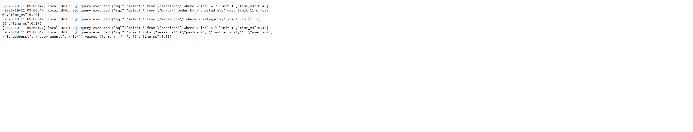

# SIPUS-Del

Nama: Dea Hutapea
NIM: 12S24053

Sistem Informasi Perpustakaan Kampus Del berbasis Laravel 11 dengan pola MVC. Aplikasi ini mengelola koleksi buku dan kategori melalui CRUD RESTful, relasi Eloquent, validasi server-side, serta tampilan Blade bertema editorial dengan warna hijau hutan dan aksen terracotta.

## Spesifikasi Teknis Wajib (Checklist Persyaratan)

- Skema Data & Migrations (Bobot: 20%): Tabel kategori (kode_kategori, nama_kategori) dan tabel buku (isbn, judul, penulis, penerbit, tahun_terbit, kategori_id foreign key, stok, sinopsis) dengan tipe data dan index yang presisi.
- Model Eloquent & Relasi (Bobot: 20%): Relasi Kategori hasMany Buku dan Buku belongsTo Kategori. Proteksi mass assignment dengan `$fillable`, serta implementasi Eager Loading (`Buku::with('kategori')`) di semua tampilan index.
- Routing RESTful & Resource Controller (Bobot: 20%): Mendaftarkan Route::resource untuk buku dan kategori. Mengimplementasikan 7 method CRUD lengkap dan menangani validasi server-side.
- Validasi Form Server-Side & CSRF (Bobot: 15%): Validasi server ketat via `$request->validate()` (ISBN unik, judul minimal 5 karakter, stok minimal 0). Seluruh form wajib menyertakan `@csrf` dan method spoofing pada edit.
- Blade Templating & Desain UI (Bobot: 15%): Menggunakan master layout `<x-layout>` dengan tema hijau hutan dan aksen terracotta, pagination aktif, notifikasi flash session, dan penanganan data kosong dengan `@forelse`.
- Seeders & Bukti Audit SQL (Bobot: 10%): Menyediakan Seeder dan Factory untuk 5 kategori dan 20 buku realistis. Audit log SQL disimpan ke `storage/logs/laravel.log` saat aplikasi berjalan di environment lokal.

## Kebutuhan

- PHP 8.2 atau lebih baru dengan ekstensi PDO SQLite
- Composer 2.6 atau lebih baru
- Node.js 18/20 dan npm

## Menjalankan aplikasi

1. Salin `.env.example` menjadi `.env`, lalu sesuaikan pengaturan lokal bila diperlukan. Jangan commit `.env`.
2. Jika database SQLite belum ada, buat file terlebih dahulu sebelum migrate:

   ```powershell
   type nul > database\database.sqlite
   ```

3. Pasang dependensi dan buat kunci aplikasi:

   ```bash
   composer install
   php artisan key:generate
   ```

4. Siapkan skema serta data contoh:

   ```bash
   php artisan migrate:fresh --seed
   ```

   Seeder membuat 5 kategori dan 20 buku contoh yang dibuat dengan data realistis.

5. Pasang dependensi frontend dan kompilasi aset Vite:

   ```bash
   npm install
   npm run build
   ```

6. Jalankan server lokal:

   ```bash
   php artisan serve
   ```

   Buka URL yang ditampilkan Artisan. Halaman `/` akan mengarahkan ke katalog buku.

## Fitur

- CRUD buku dengan ISBN unik 13 digit, kategori, stok, sinopsis, dan validasi input server-side.
- CRUD kategori; kategori yang masih memiliki buku tidak dapat dihapus agar data buku tetap utuh.
- Relasi `Kategori::bukus()` dan `Buku::kategori()` dengan proteksi mass assignment melalui `$fillable`.
- Katalog menggunakan `Buku::with('kategori')` dan simple pagination untuk menghindari N+1 sekaligus membatasi kueri daftar menjadi satu kueri buku dan satu kueri kategori.
- Seluruh form memakai CSRF, form edit memakai method spoofing, dan output Blade di-escape secara default.
- Layout Blade `<x-layout>` dengan notifikasi flash, tampilan kosong `@forelse`, serta tema hijau hutan, warna kertas, dan aksen terracotta.

## Bukti audit query



Log lokal di atas diambil setelah membuka `/buku`. Terlihat satu query `bukus` dengan `limit 11` (10 data per halaman ditambah satu data untuk memeriksa halaman berikutnya) dan satu query eager loading `kategoris` dengan `where ... in (...)`. Query `sessions` juga dapat muncul karena konfigurasi session database; query itu bukan query katalog tambahan.

## Pengujian

Jalankan pengujian fitur:

```bash
php artisan test
```

Tes katalog mengaudit kueri yang berjalan dan memastikan hanya ada satu kueri untuk buku serta satu kueri eager load kategori. Saat aplikasi berjalan dengan `APP_ENV=local`, listener pada `AppServiceProvider` mencatat SQL dan waktu eksekusi ke `storage/logs/laravel.log`.

## Catatan dependency

- `laravel/boost` hadir sebagai alat bantu pengembangan lokal dan tidak menjadi bagian inti dari modul; file `boost.json` serta package `laravel/boost` tetap disimpan di repositori untuk menjaga proses pengembangan agar konsisten.
- Sementara itu, konfigurasi `composer.json` menyetel `"advisories": { "block": false }` untuk menyesuaikan kebutuhan pengembangan lokal agar proses setup tetap berlanjut tanpa blokir oleh advisories non-kritis.

## Skema utama

- `kategoris`: `kode_kategori` unik (maks. 10 karakter) dan `nama_kategori` (maks. 100 karakter).
- `bukus`: ISBN unik 13 digit, judul, penulis, penerbit, tahun terbit, foreign key kategori, stok non-negatif, dan sinopsis opsional.
- Foreign key buku ke kategori membatasi penghapusan kategori yang masih digunakan.
